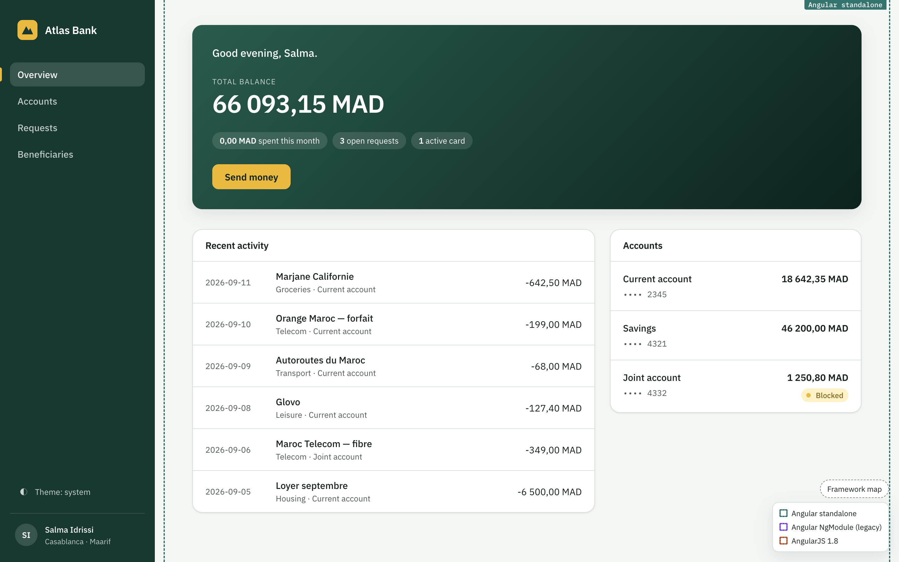
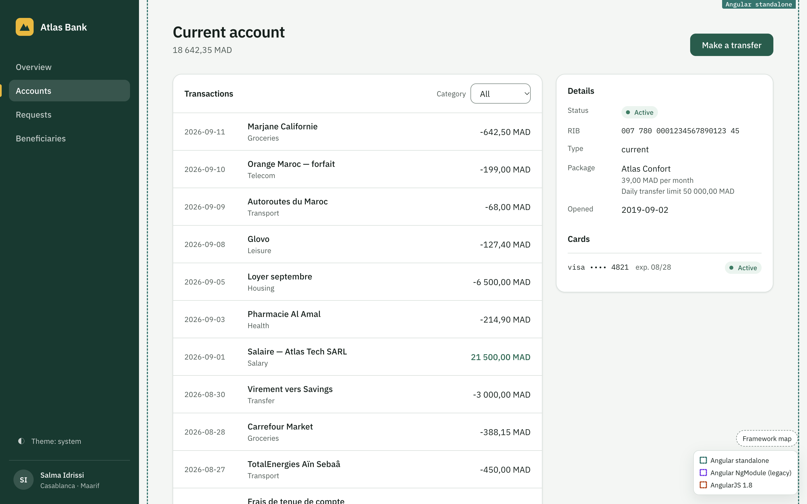
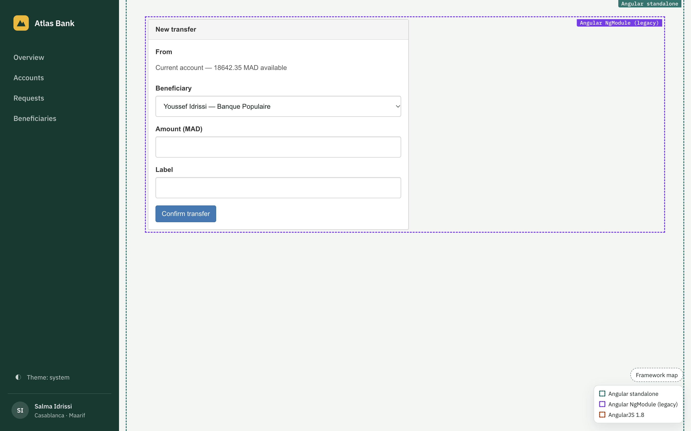
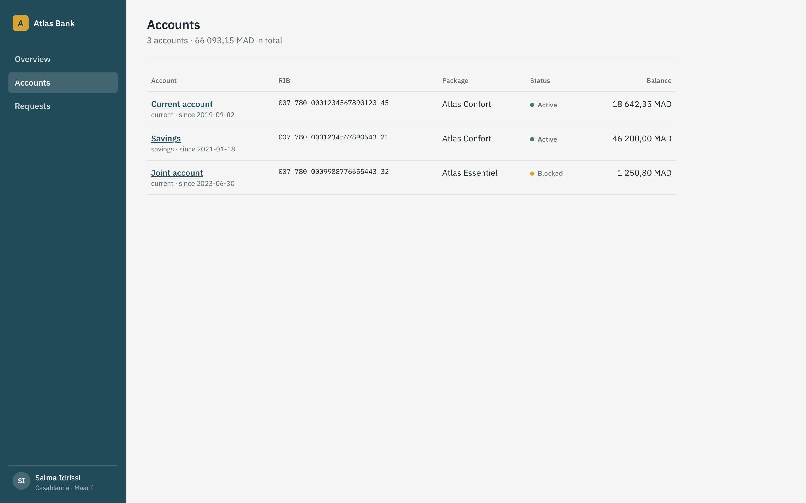
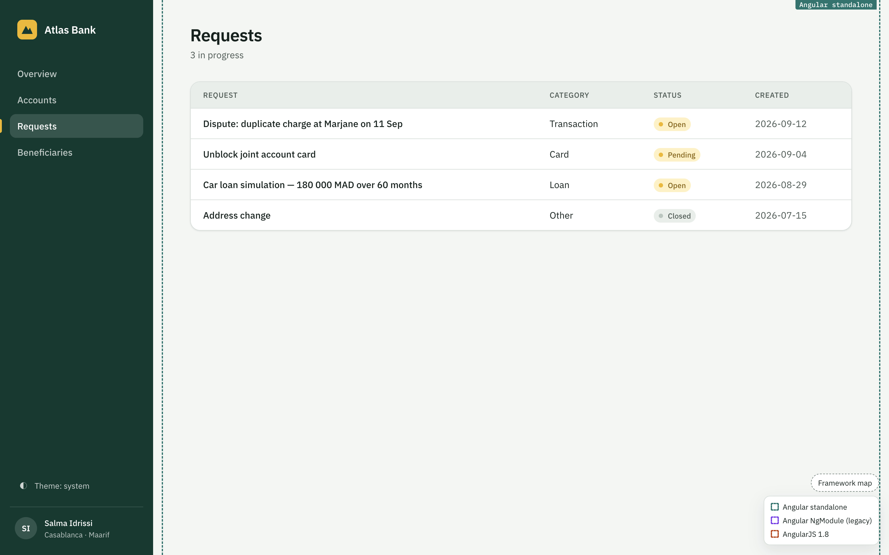
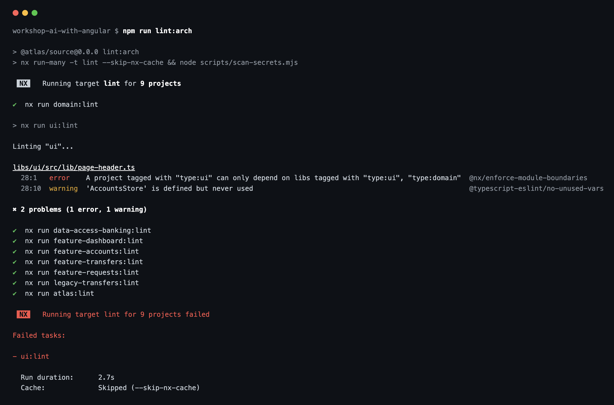

# Fast and safe: AI in your Angular codebase

The demo repository of the workshop **[Fast and safe: AI in your Angular codebase](https://tt-tech.io/workshops/ai-with-angular)** by [TT Tech](https://tt-tech.io). Web banking for *Atlas Bank*, an imaginary Moroccan bank: accounts and transactions, cards, requests, and a frozen legacy transfers module waiting to be migrated. Every exercise in the workshop runs on this codebase.



Live demo: https://tt-tech.github.io/workshop-ai-with-angular/ (goes live once GitHub Pages is enabled for this repo; in-memory demo data, resets on reload).

- Angular 22 · Nx · standalone components + signals · zoneless · Vitest
- Architecture enforced by ESLint module boundaries (and, for non-Nx teams, the same contract in `sheriff.config.ts`)
- Agent guidance in one place: `AGENTS.md`. Claude Code, Cursor, Copilot and Gemini CLI files only point to it.

## What you work on

<table>
<tr>
<td width="50%"><br><sub><b>Account detail.</b> Signals store, category filter, MAD formatting from the domain lib.</sub></td>
<td width="50%"><br><sub><b>The legacy corner.</b> An NgModule transfer form with <code>*ngIf</code> and <code>any</code>: module 2 migrates it with an agent, behind tests that pin its behaviour first.</sub></td>
</tr>
<tr>
<td width="50%"><br><sub><b>Accounts.</b> List and status badges from the presentational UI lib.</sub></td>
<td width="50%"><br><sub><b>Requests.</b> Open and closed customer requests.</sub></td>
</tr>
</table>

### The guard rail an agent hits

A UI component imports a store, and `npm run lint:arch` stops it. The same check runs whoever wrote the code: you, Claude Code, Cursor or Copilot.



## Run

```bash
npm install
npm start            # http://localhost:4200
npm run test
npm run lint:arch    # boundaries + house rules
npm run typecheck
```

## Architecture

Diagrams (dependency contract, runtime flow, legacy corner, agent guidance, git tags): [`docs/architecture.md`](docs/architecture.md).

## Layout

```
apps/atlas                     shell + routes only
libs/domain                   pure TS: models, canTransfer(), formatRib(), formatMad()
libs/data-access/banking      FakeBackend (the boundary) + AccountsStore, CardsStore, RequestsStore (signals)
libs/ui                       StatusBadge, PageHeader, Amount, MadPipe (presentational)
libs/feature/dashboard        overview route
libs/feature/accounts         list + detail routes
libs/feature/requests         list route
libs/legacy/transfers         NgModule + *ngIf + constructor DI + any — the module-2 migration target
docs/tasks                    task-file template + tasks 001 (module 1), 002/003 (module 2)
exercises                     one file per workshop module
```

## Exercises

| Module | File | Git tags used |
|---|---|---|
| 1 — AI-assisted workflow | `exercises/m1-ai-assisted-workflow.md` | `m1-unconstrained`, `m1-with-rules` |
| 2 — Modernising legacy Angular with agents | `exercises/m2-modernising-legacy.md` | `m2-start`, `m2-migrated` |
| 3 — Building an AI feature | *(coming)* | |

## Licence

MIT. Imaginary data; no real bank, customer or client code.
