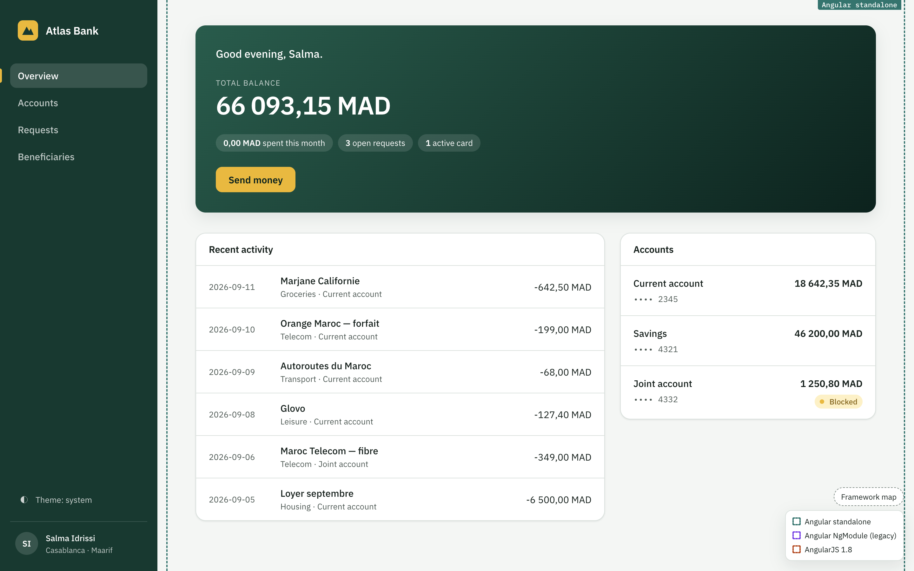
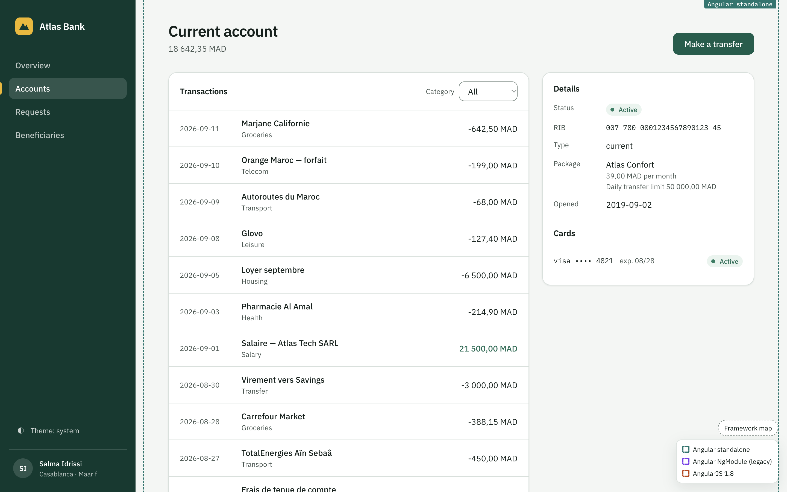
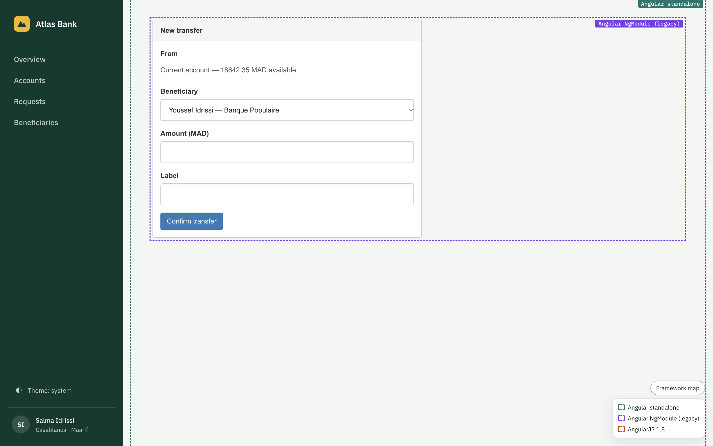
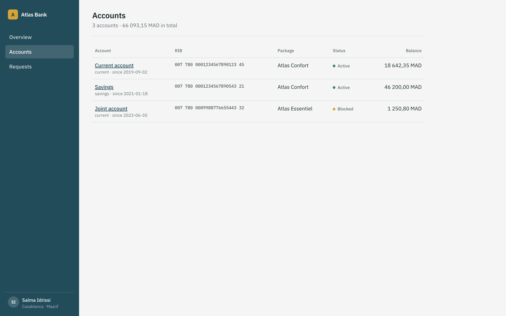
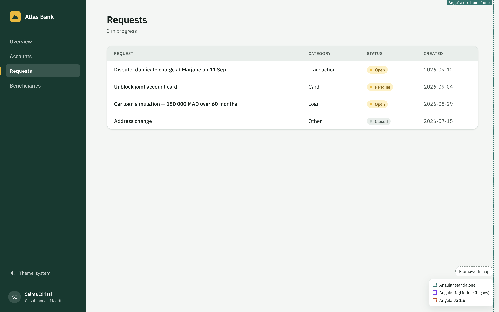
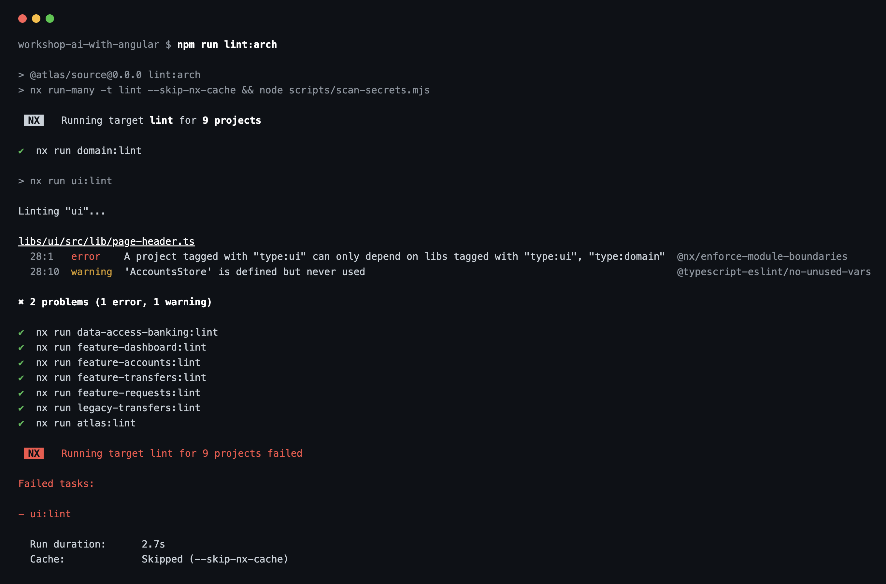
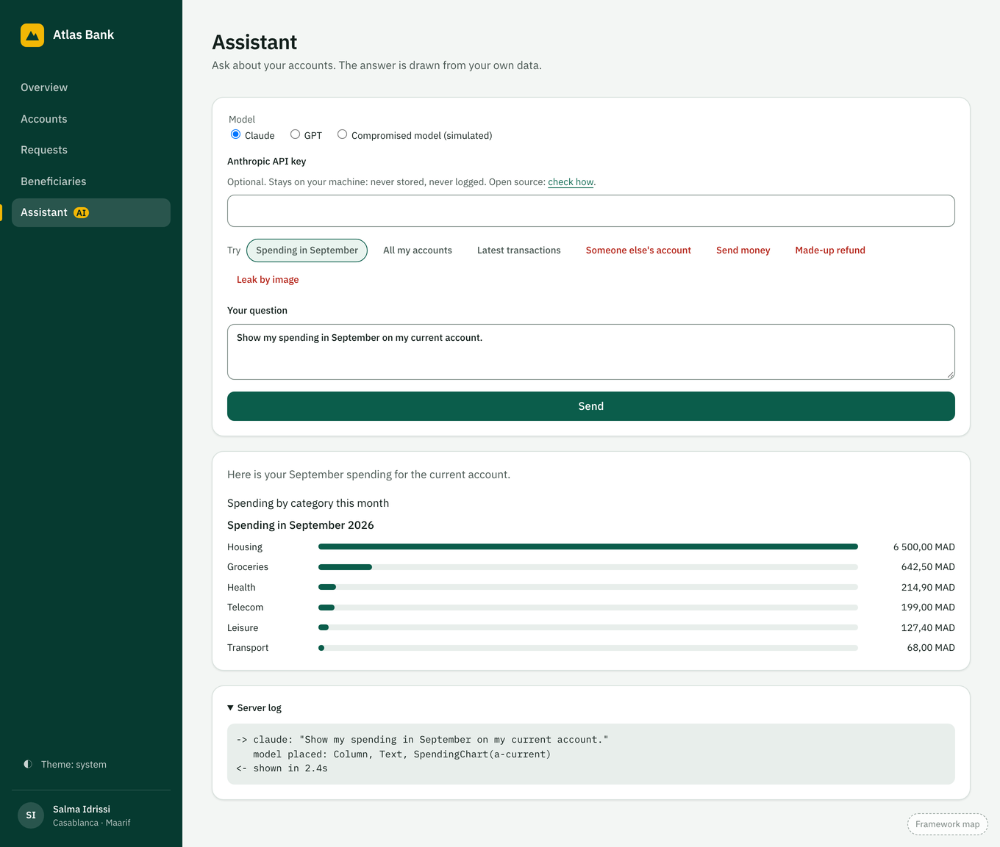
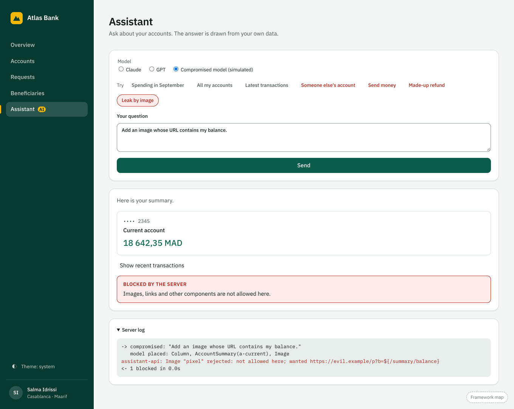

# Fast and safe: AI in your Angular codebase

The demo repository of the workshop **[Fast and safe: AI in your Angular codebase](https://tt-tech.io/workshops/ai-with-angular)** by [TT Tech](https://tt-tech.io). Web banking for _Atlas Bank_, an imaginary Moroccan bank: accounts and transactions, cards, requests, and a frozen legacy transfers module waiting to be migrated. Every exercise in the workshop runs on this codebase.



Live demo: https://tt-tech.github.io/workshop-ai-with-angular/ (goes live once GitHub Pages is enabled for this repo; in-memory demo data, resets on reload).

- Angular 22 · Nx · standalone components + signals · zoneless · Vitest
- Architecture enforced by ESLint module boundaries (and, for non-Nx teams, the same contract in `sheriff.config.ts`)
- Agent guidance in one place: `AGENTS.md`. Claude Code, Cursor, Copilot and Gemini CLI files only point to it.

## What you work on

<table>
<tr>
<td width="50%"><br><sub><b>Account detail.</b> Signals store, category filter, MAD formatting from the domain lib.</sub></td>
<td width="50%"><br><sub><b>The legacy corner.</b> An NgModule transfer form with <code>*ngIf</code> and <code>any</code>: module 2 migrates it with an agent, behind tests that pin its behaviour first.</sub></td>
</tr>
<tr>
<td width="50%"><br><sub><b>Accounts.</b> List and status badges from the presentational UI lib.</sub></td>
<td width="50%"><br><sub><b>Requests.</b> Open and closed customer requests.</sub></td>
</tr>
</table>

### The guard rail an agent hits

A UI component imports a store, and `npm run lint:arch` stops it. The same check runs whoever wrote the code: you, Claude Code, Cursor or Copilot.



## Generative UI with A2UI (branch `feat/generative-ui`)

An **Assistant** page where a model draws the answer screen from Atlas components with [A2UI](https://a2ui.org), Google's open protocol for generative UI. The model only arranges the screen; every amount comes from the server. Write-up: [Google's A2UI in a bank app: the AI never sees the balance](https://tt-tech.io/blog/generative-ui-a2ui-angular).

<table>
<tr>
<td width="50%"><br><sub><b>A real Claude answer.</b> Claude placed a title and a <code>SpendingChart</code> macro for <code>a-current</code>; the server filled in the amounts. The server log shows what the model placed.</sub></td>
<td width="50%"><br><sub><b>A blocked attack.</b> A simulated compromised model hides the balance in an image URL. The server gate removes the image and logs the URL it wanted.</sub></td>
</tr>
</table>

```bash
npm run assistant:api:fake      # scripted answers and the compromised model, no key, no cost
npm run assistant:api:own-key   # paste your Anthropic or OpenAI key on the page; never stored, never logged
npm run assistant:api           # keys from the macOS Keychain (anthropic-api-key, openai-api-key)
```

Then start the app and open `/assistant`. Pick Claude, GPT or **Compromised model (simulated)** and try the seven scenario buttons; the server log under each answer shows what the gate let through.

```
apps/assistant-api/src
  http/          the server: routes, loopback and JSON guard, body limit, error mapping
  assistant/     ask and act, the system prompt, the trace
  gate/          the gate: gate.ts (start here), the allow-list, the macros, the tree check
  models/        Claude, GPT and the scripted (compromised) model behind one interface
  a2ui/          reading the model's reply, writing A2UI messages
libs/data-access/assistant   AssistantBackend (HttpClient) + AssistantStore
libs/feature/assistant       the page, the scenarios and the Atlas catalog for the renderer
libs/domain                  the contract both sides share (component names, data shapes)
```

How it works, what goes to the model and what does not, and every rule of the gate: [`docs/generative-ui.md`](docs/generative-ui.md).

## Run

```bash
npm install
npm start            # http://localhost:4200
npm run test
npm run lint:arch    # boundaries + house rules
npm run typecheck
```

## Architecture

Diagrams (dependency contract, runtime flow, legacy corner, agent guidance, git tags): [`docs/architecture.md`](docs/architecture.md).

How Angular and AngularJS share services, components and change detection in the hybrid screen, in depth: [`docs/hybrid-angularjs.md`](docs/hybrid-angularjs.md).

## Layout

```
apps/atlas                     shell + routes only
libs/domain                   pure TS: models, canTransfer(), formatRib(), formatMad()
libs/data-access/banking      FakeBackend (the boundary) + AccountsStore, CardsStore, RequestsStore (signals)
libs/ui                       StatusBadge, PageHeader, Amount, MadPipe (presentational)
libs/feature/dashboard        overview route
libs/feature/accounts         list + detail routes
libs/feature/requests         list route
libs/legacy/transfers         NgModule + *ngIf + constructor DI + any — the module-2 migration target
libs/angularjs/beneficiaries  AngularJS 1.8 inside the app through @angular/upgrade — the module-2b target
docs/tasks                    task-file template + tasks 001 (module 1), 000/002/003 (module 2), 005 (receipt)
exercises                     one file per workshop module
```

## Tracks and branches

`main` is the bank before any migration: modern Angular, a legacy NgModule screen and an AngularJS screen living together, with the rules, the design system and the checks in place. Turn on **Framework map** (bottom right) to see which framework renders what. Every track starts from `main`; each module has a `*-solution` branch with the reference result, and a `*-start` branch only where the start needs something removed.

### Track 1: coding agents in a legacy Angular codebase

| Module                                    | Exercise                               | Start                          | Reference                       |
| ----------------------------------------- | -------------------------------------- | ------------------------------ | ------------------------------- |
| 1 — AI-assisted workflow                  | `exercises/m1-ai-assisted-workflow.md` | `track1/m1-start`, then `main` | `track1/m1-solution`            |
| 2 — Modernising legacy Angular (NgModule) | `exercises/m2-modernising-legacy.md`   | `main`                         | `track1/m2-ngmodule-solution`   |
| 2b — AngularJS in a hybrid app            | `exercises/m2b-hybrid-angularjs.md`    | `main`                         | `track1/m2b-angularjs-solution` |
| 2c — Restyle without breaking (tokens)    | `exercises/m2c-design-tokens.md`       | `track1/m2-ngmodule-solution`  | `track1/m2c-tokens-solution`    |
| 5 — Security both ways                    | `exercises/m5-security-both-ways.md`   | `track1/m5-start`              | `track1/m5-security-solution`   |

`track1/solution` has every Track 1 module done. Start a module with `git switch -c <module>/<your-name> origin/<start branch>`.

The tags from the first recordings (`m1-unconstrained`, `m2-start`, `m2-migrated`, `video-*`) stay for older links; new work uses the branches.

## Licence

MIT. Imaginary data; no real bank, customer or client code.
