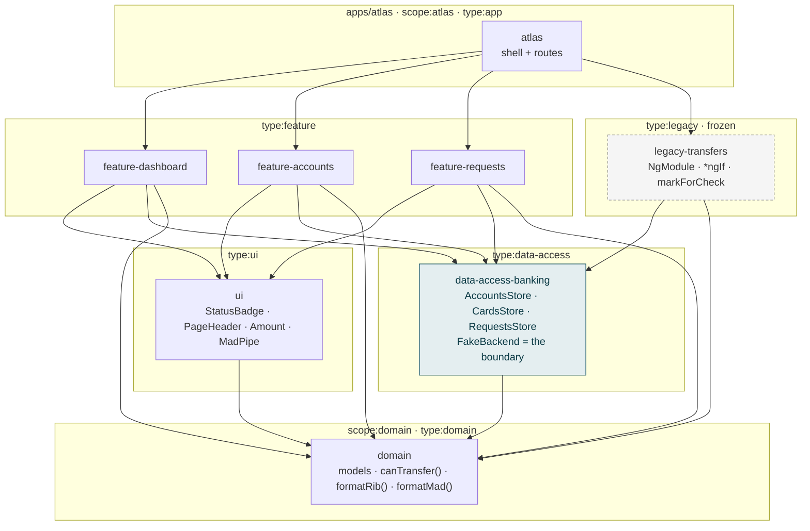
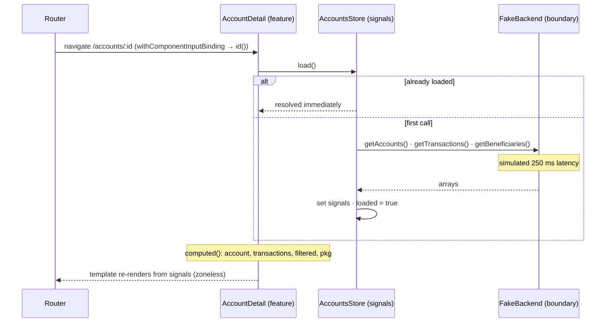
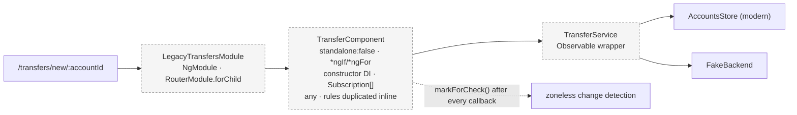
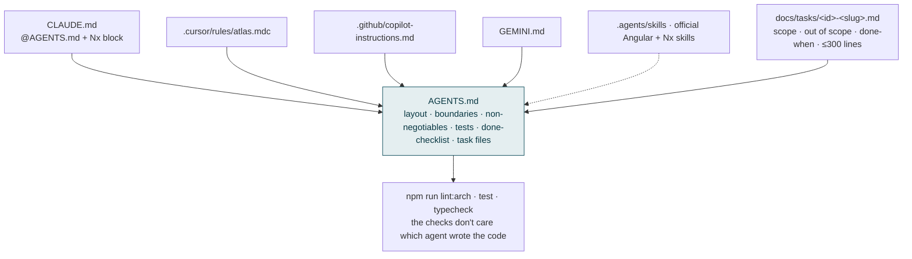
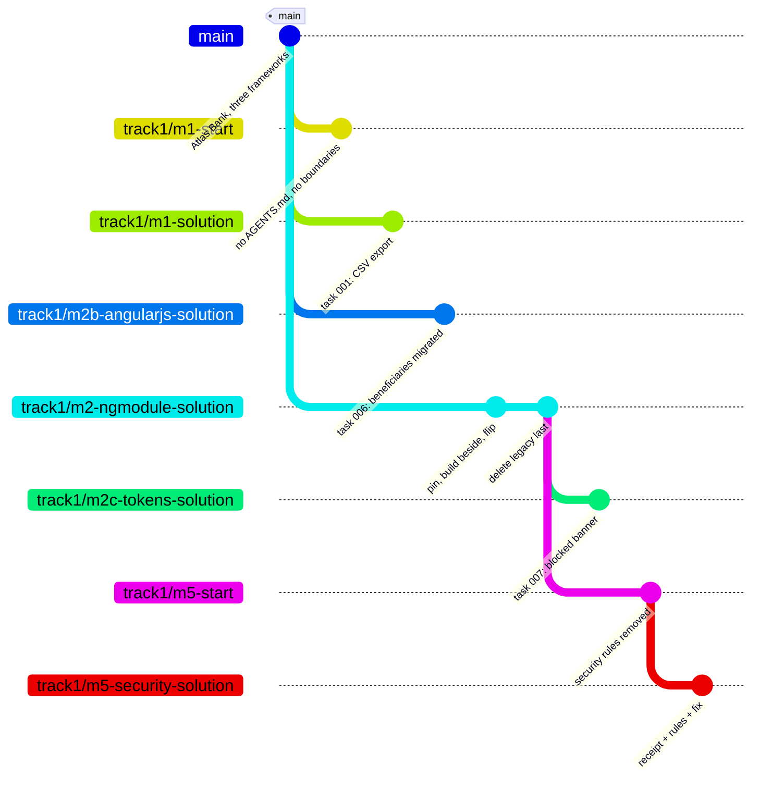
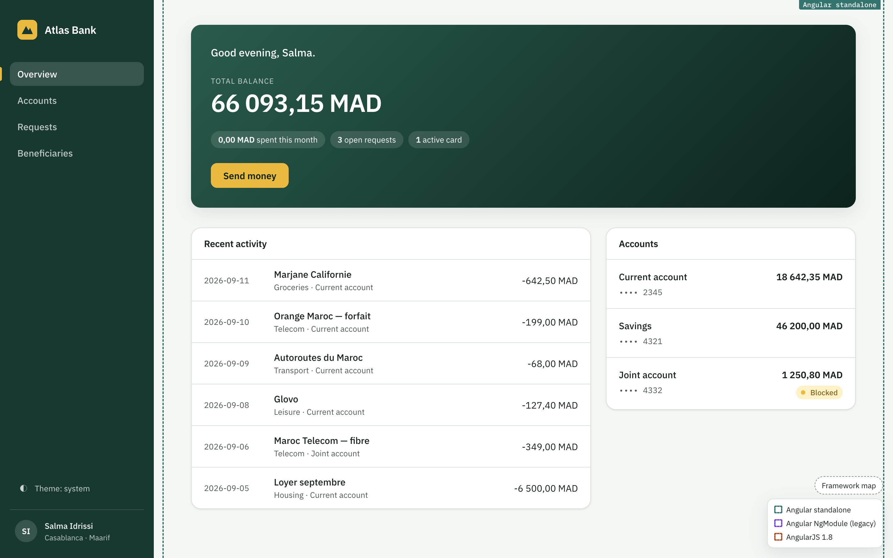
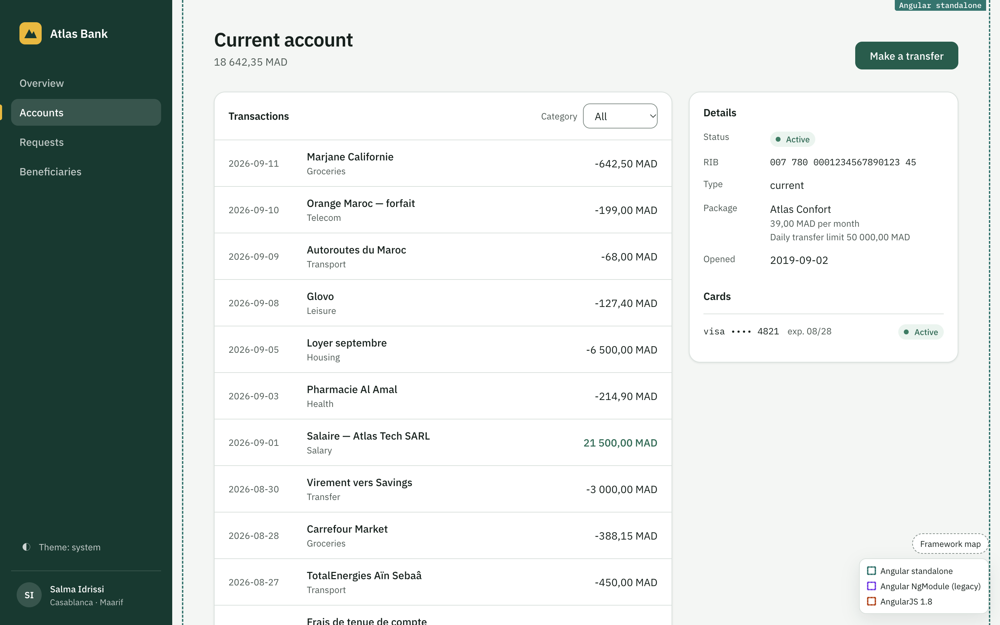
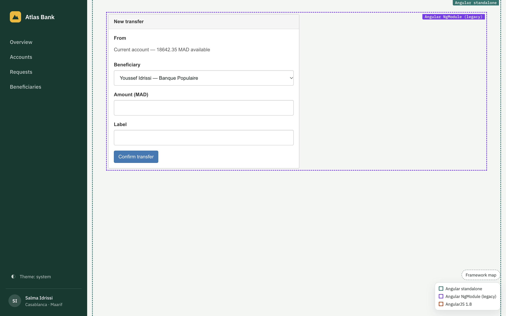

# Architecture

Atlas Bank is small on purpose: enough shape to feel like an enterprise Angular codebase, small enough to read in an hour. Every diagram below is generated from what the linter enforces, not from intention.

## 1. Libraries and the dependency contract

Arrows mean "may import". Anything not drawn is a lint error (`npm run lint:arch`).

Rules encoded in `eslint.config.mjs` (`depConstraints`) and mirrored in `sheriff.config.ts`:

| Tag                | May depend on                    |
| ------------------ | -------------------------------- |
| `type:domain`      | nothing                          |
| `type:data-access` | data-access, domain              |
| `type:ui`          | ui, domain                       |
| `type:feature`     | feature, ui, data-access, domain |
| `type:legacy`      | legacy, data-access, domain      |
| `type:app`         | everything                       |
| `scope:domain`     | scope:domain only                |
| `scope:atlas`      | scope:atlas, scope:domain        |

Two things the diagram makes visible that a folder tree does not: `ui` never reaches `data-access` (presentational components take inputs), and `legacy` may read the modern stores but nothing modern imports legacy — the arrow only points one way, which is what makes it deletable later.

## 2. Runtime: how a page gets its data

The store's `load()` is idempotent while in flight — concurrent callers share one promise. Tests rely on this: `await TestBed.inject(AccountsStore).load()` resolves exactly when the component's own load resolves.

## 3. The legacy corner (module 2 target)

What is wrong with it, on purpose: business rules that already exist as `canTransfer()` in `libs/domain` are re-implemented inline with a magic limits table; state is plain fields kept alive by `markForCheck()`; the component both fetches and validates. The migration exercise removes all three without changing behaviour.

## 4. Agent guidance: one source of truth, any tool

## 5. Tracks in git

`main` is the start of every track: nothing migrated, all rules on. A `*-start` branch exists only where a module starts from less than `main` (module 1 without guidance, module 5 without the security rules). `track1/solution` merges every Track 1 solution. When `main` changes, the track branches are rebased onto it, so a reference never drifts from the code people start with.

## Screenshots

Taken from the running app (`npm start`, 1440×900, light). Files live in `docs/screenshots/`.

| File                     | Route                      | Shows                                                         |
| ------------------------ | -------------------------- | ------------------------------------------------------------- |
| `01-overview.png`        | `/`                        | balance figure, three numbers, recent activity, accounts rail |
| `02-accounts.png`        | `/accounts`                | list with formatted RIBs, package, status, balance            |
| `03-account-detail.png`  | `/accounts/a-current`      | transactions with category filter, details, cards             |
| `04-requests.png`        | `/requests`                | request list                                                  |
| `05-legacy-transfer.png` | `/transfers/new/a-current` | the frozen legacy form, deliberately dated                    |
| `06-lint-arch-fail.png`  | terminal                   | `npm run lint:arch` failing on a `ui → data-access` import    |

