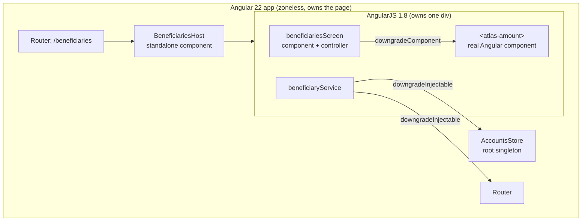
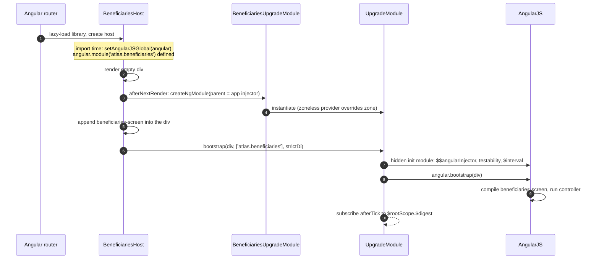
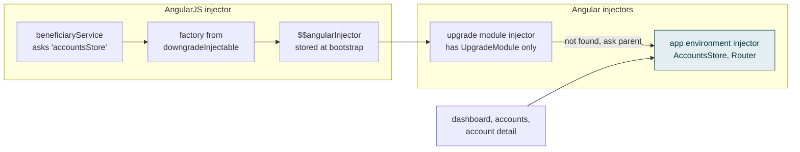
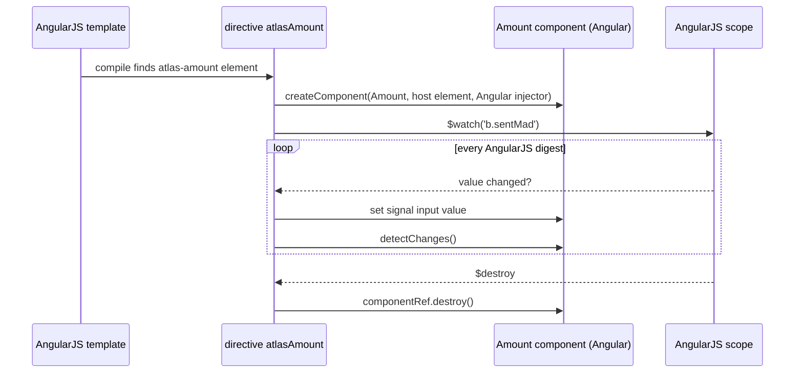
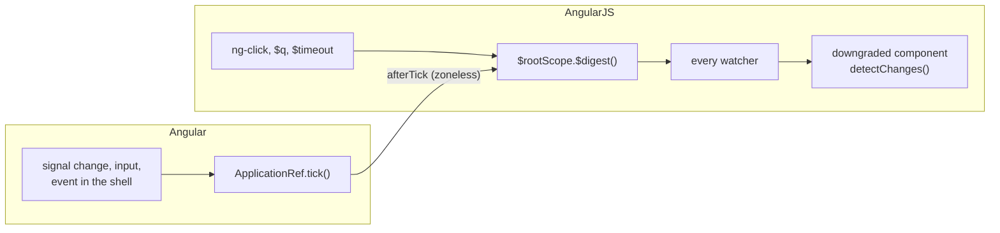
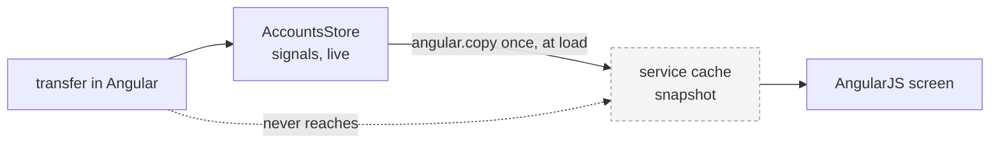
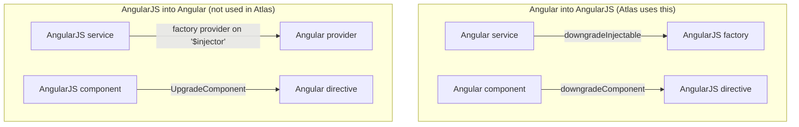
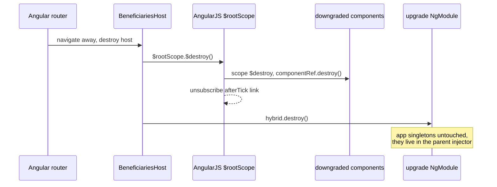
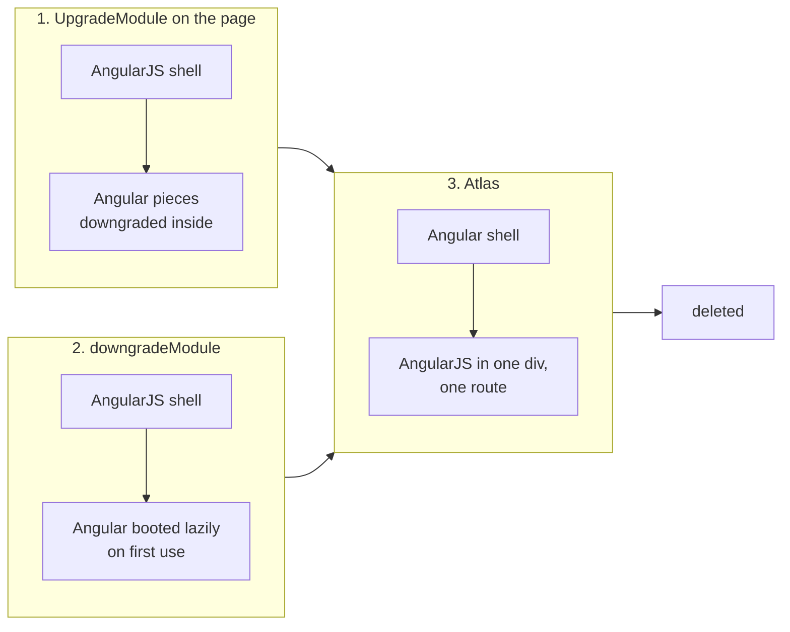

# How Angular and AngularJS run together in Atlas Bank

This is the long version of how the beneficiaries screen works: an AngularJS 1.8 screen inside a zoneless Angular 22 app, sharing services and components in both directions. It is written for the person who wants to understand the mechanism, not only use it. Exercise `m2b-hybrid-angularjs.md` is where you change it; this file is where you learn why it behaves the way it does.

Everything here is checked against `@angular/upgrade` 22.1 (`node_modules/@angular/upgrade/fesm2022/static.mjs`). Line references to that file are given so you can read the source yourself.

## 1. Who owns what



Angular is the root. It renders the shell, owns the router and every other screen. AngularJS exists only while `/beneficiaries` is open, and only inside one `<div>` of `BeneficiariesHost`. This is the end state of most migrations, the opposite of where they start (see section 8).

The files:

| File                                                           | Role                                                           |
| -------------------------------------------------------------- | -------------------------------------------------------------- |
| `apps/atlas/src/app/app.routes.ts`                             | lazy route `beneficiaries` to `@atlas/angularjs-beneficiaries` |
| `libs/angularjs/beneficiaries/src/lib/beneficiaries.routes.ts` | one route, component `BeneficiariesHost`                       |
| `beneficiaries-host.ts`                                        | Angular component that boots and destroys AngularJS            |
| `beneficiaries.module.ts`                                      | the AngularJS module and the three bridges                     |
| `beneficiaries.component.ts`, `.template.ts`                   | the AngularJS screen                                           |
| `beneficiary.service.ts`                                       | the AngularJS service, uses the store and the router           |
| `beneficiaries-host.spec.ts`                                   | tests the whole hybrid through the DOM                         |

## 2. Boot, step by step



1. **The route loads.** The router lazy-loads the library and creates `BeneficiariesHost`. Its template is one empty `<div #root data-framework="angularjs">`.

2. **Import side effect: `setAngularJSGlobal(angular)`.** `beneficiaries.module.ts` imports AngularJS as an ES module, so there is no `window.angular` the upgrade library could find. This call hands it the instance to use. It runs once, when the module file is first imported.

3. **The AngularJS module is defined.** Also at import time, `angular.module('atlas.beneficiaries', [])` registers the screen, the service and the three bridges. Nothing runs yet: an AngularJS module is only a recipe until something bootstraps it.

4. **After the first render, the host creates an NgModule.** `afterNextRender` waits until the `<div>` is in the DOM. Then:

   ```ts
   hybrid = createNgModule(BeneficiariesUpgradeModule, environment);
   ```

   `environment` is the host's `EnvironmentInjector`, which is the app's. That parent link is the single most important line in the hybrid: every Angular service AngularJS asks for is resolved through it, so it gets the app's singletons, not new copies (section 3).

   Why an NgModule in a standalone app? `UpgradeModule` is still an NgModule and has to be instantiated as one. `BeneficiariesUpgradeModule` is a five-line technical wrapper, not legacy code.

5. **Zoneless is kept.** `UpgradeModule`'s own providers include zone-based change detection (`static.mjs` around line 1169). In a zoneless app that throws `NG0908: In this configuration Angular requires Zone.js`. The wrapper adds `provideZonelessChangeDetection()`, which overrides it.

6. **AngularJS is bootstrapped on the div.** The host appends `<beneficiaries-screen>` into the div and calls:

   ```ts
   hybrid.injector
     .get(UpgradeModule)
     .bootstrap(element, [beneficiariesModule.name], { strictDi: true });
   ```

   Inside, `UpgradeModule.bootstrap` (line 1059) creates a hidden AngularJS module that:
   - stores the Angular injector as the AngularJS value `$$angularInjector`
   - wires AngularJS testability and `$interval` to Angular
   - subscribes AngularJS's digest to Angular's change detection (section 5)

   then runs `angular.bootstrap(element, ['ng-upgrade-init', 'atlas.beneficiaries'], config)`. From that moment the div is an AngularJS application with its own `$rootScope` and `$injector`.

7. **`strictDi: true`.** AngularJS normally guesses dependencies from parameter names, which breaks after minification. Strict mode refuses to guess, which is why the service and controller list their dependencies as strings in an array before the function:

   ```ts
   export const beneficiaryService = ['$q', '$filter', '$timeout', '$window', 'accountsStore', 'ngRouter', (...) => { ... }];
   ```

## 3. Angular services inside AngularJS: `downgradeInjectable`

```ts
.factory('accountsStore', downgradeInjectable(AccountsStore))
.factory('ngRouter', downgradeInjectable(Router))
```

`downgradeInjectable` (line 514) returns an ordinary AngularJS factory, roughly:

```ts
const factory = ($injector) =>
  $injector.get('$$angularInjector').get(AccountsStore);
factory.$inject = ['$injector'];
```



So when the AngularJS service asks for `'accountsStore'`:

1. AngularJS's injector runs the factory.
2. The factory reads `$$angularInjector`, the Angular injector stored during bootstrap.
3. It asks that injector for the `AccountsStore` class.
4. The upgrade module's injector does not have it, so it asks its parent: the app's environment injector, which has the `providedIn: 'root'` instance.

Result: the dashboard, the account screens and the AngularJS screen hold **the same object**. A transfer made in Angular changes the store the AngularJS service reads.

AngularJS caches factory results, so the lookup happens once per AngularJS app, that is once per visit of the route.

**What the compiler cannot see.** The link between `'accountsStore'` in the service's dependency array and the `.factory('accountsStore', ...)` registration is a string. Rename either and TypeScript, ESLint and the build stay green; the screen fails at runtime. The service also types most things as `any`. That is the "readers the compiler cannot see" problem, and the reason `beneficiaries-host.spec.ts` exists.

## 4. Angular components inside AngularJS templates: `downgradeComponent`

```ts
.directive('atlasAmount', downgradeComponent({ component: Amount }) as angular.IDirectiveFactory)
```

```html
<td class="num"><atlas-amount [value]="b.sentMad"></atlas-amount></td>
```



**The name.** AngularJS directives are registered in camelCase and used in kebab-case: `atlasAmount` matches `<atlas-amount>`. The Angular selector of `Amount` is also `atlas-amount`, but AngularJS never reads it; only the registration name counts. Register it as `atlasMoney` and AngularJS treats `<atlas-amount>` as an unknown element and renders nothing, with no error (exercise m2b, scene 1).

**Creation.** When AngularJS compiles the element, the directive (built by `DowngradeComponentAdapter`, around line 190) calls Angular's `createComponent()` for `Amount` with:

- the host element: the `<atlas-amount>` element AngularJS found
- the element injector: the Angular injector from `$$angularInjector`, so the component can inject the same services as anywhere else

The result is a real Angular component, with its own view, styles and change detector, living inside an AngularJS template.

**Inputs.** The attribute `[value]="b.sentMad"` uses Angular binding syntax, but the expression `b.sentMad` is evaluated by **AngularJS** on the AngularJS scope. The adapter:

1. registers `scope.$watch('b.sentMad', ...)`
2. on every change, writes the new value into the component. For a signal input like `value = input.required<number>()` it uses the signal's internal input setter (`applyValueToInputSignal`, line 360), the same path a normal Angular template uses
3. marks the component's view for check

Plain attributes (`value="12"`) are read with `$observe` as strings. `ngOnChanges` is called if the component has it.

**Outputs.** `(changed)="vm.onChange($event)"` would subscribe to the component's output and evaluate the AngularJS expression on emit (line 319). `Amount` has no outputs, so Atlas does not use it.

**Change detection of the component.** The adapter adds a watcher on the scope that calls `changeDetectorRef.detectChanges()` on every AngularJS digest (line 287). So a downgraded component is re-rendered whenever AngularJS digests, whatever triggered it.

**Content projection.** Children of `<atlas-amount>` in the AngularJS template would be projected into the component's `<ng-content>`. `Amount` has none.

## 5. Change detection in both directions, zoneless

There are two separate change detection systems:

- Angular: signals and `ApplicationRef.tick()`, scheduled by the zoneless scheduler when a signal read by a template changes, an input is set, an event handler runs, and so on
- AngularJS: `$rootScope.$digest()`, which runs every watcher until nothing changes. AngularJS triggers it itself after `ng-click`, `$timeout`, `$q` callbacks and `$http`

`UpgradeModule.bootstrap` links them (line 1110):

```ts
const subscription =
  this.ngZone instanceof NoopNgZone
    ? this.applicationRef.afterTick.subscribe(() => synchronize()) // zoneless: Atlas
    : this.ngZone.onMicrotaskEmpty.subscribe(() => synchronize()); // with zone.js
```

`synchronize()` runs `$rootScope.$digest()` or, if a digest is already running, `$evalAsync()`.



So:

| Something happens in                              | What runs                                                                                                                                                         |
| ------------------------------------------------- | ----------------------------------------------------------------------------------------------------------------------------------------------------------------- |
| Angular (a signal changes, a click in the shell)  | Angular ticks, then `afterTick` makes AngularJS digest. Every AngularJS watcher re-evaluates.                                                                     |
| AngularJS (`ng-click`, `$q` resolves, `$timeout`) | AngularJS digests. Each downgraded component's watcher calls its `detectChanges()`, so `<atlas-amount>` re-renders. Angular's app-wide tick does not need to run. |

With zone.js the same link uses `onMicrotaskEmpty` instead. That is the only difference; the rest of the hybrid does not care which mode the app runs in.



**The trap: copies are not live.** The service does this when it loads:

```ts
cache.accounts = angular.copy(accountsStore.accounts());
```

`accountsStore.accounts()` is a signal read, but AngularJS is not a reactive context, so nothing subscribes to it. `angular.copy` then takes a deep snapshot. Later changes in the store do not reach the AngularJS screen: a digest re-runs the watchers, but the watchers look at the copy. The screen shows fresh data only the next time it is opened. The digest link above keeps the two frameworks rendering in step; it does not keep their data in step. To read live data from AngularJS, read the signal inside a watcher or a template expression (`$watch(() => accountsStore.accounts())`), not once at load.

**The warning you may see.** "A digest was triggered while one was already in progress" (line 1115) means something called into Angular from inside an AngularJS digest and Angular's tick tried to digest again. The library falls back to `$evalAsync`, so it is harmless, but it points at code that mixes the two loops.

## 6. The other direction: AngularJS inside Angular

Atlas only goes one way: Angular pieces inside AngularJS. The reverse exists too, and in an AngularJS-rooted app it is used every day. Atlas does not use these, so the examples below are illustrations, not repo code.



**AngularJS services in Angular.** `UpgradeModule` registers four providers in its Angular injector: `'$injector'`, `'$rootScope'`, `'$compile'`, `'$parse'` (line 783). Any AngularJS service can be exposed from there with a factory provider:

```ts
export const legacyBeneficiaryService = {
  provide: BeneficiaryServiceToken,
  useFactory: (i: angular.auto.IInjectorService) => i.get('beneficiaryService'),
  deps: ['$injector'],
};
```

The `'$injector'` token only exists inside the injector of the module that imports `UpgradeModule`, and only after AngularJS has bootstrapped. In Atlas that is `BeneficiariesUpgradeModule`, created after the host's first render; a root-level Angular service could not inject it.

**AngularJS components in Angular templates: `UpgradeComponent`.** You write a small Angular directive that names the AngularJS component and declares its bindings:

```ts
@Directive({ selector: 'legacy-beneficiary-card' })
export class LegacyBeneficiaryCard extends UpgradeComponent {
  @Input() beneficiary!: Beneficiary;
  constructor() {
    super('beneficiaryCard', inject(ElementRef), inject(Injector));
  }
}
```

Angular creates the directive; `UpgradeComponent` compiles the AngularJS component's template with `$compile`, creates its controller and maps bindings: `<` and `=` become inputs, `@` an attribute input, `&` an output. Limits enforced by the library (around line 575): no `replace`, no `terminal`, no asynchronous `templateUrl` unless the template is already in `$templateCache`, and bindings on either `scope` or `bindToController`, not both. `UpgradeComponent` receives values through `ngOnChanges` and writes two-way bindings back to plain properties (line 934 onwards), so the classic `@Input()` is the safe form here. In this repo that would be an exception to the signal rule, and needs an ADR.

**Atlas uses neither, on purpose.** The AngularJS part here is a whole routed screen, so the host component embeds the full AngularJS app instead of upgrading pieces one by one. That keeps the AngularJS code in one box with one entry point, which is what makes it deletable in one step.

## 7. Teardown

When the user leaves `/beneficiaries`, Angular destroys `BeneficiariesHost`, and its `DestroyRef` callback runs:

```ts
hybrid?.injector.get(UpgradeModule).$injector.get('$rootScope').$destroy();
hybrid?.destroy();
```



1. `$rootScope.$destroy()` destroys every scope. Every watcher is removed, every downgraded component's scope is destroyed, and the adapter destroys the Angular component it created (its `ComponentRef`). The `$destroy` event also unsubscribes the `afterTick` link from section 5.
2. `hybrid.destroy()` destroys the upgrade NgModule and its injector. The app's singletons are not touched: they belong to the parent.

Without step 1, every visit to the page would leave one more AngularJS app digesting after every Angular tick, and leak the components inside it.

The next visit starts again at step 4 of section 2, with a fresh AngularJS app. `setAngularJSGlobal` and the module definition do not run again: they happened at import time.

## 8. Other ways to set up a hybrid

| Setup                                        | Who is root                                                                               | When AngularJS runs                           | Change detection link                                                       | Typical for                                                    |
| -------------------------------------------- | ----------------------------------------------------------------------------------------- | --------------------------------------------- | --------------------------------------------------------------------------- | -------------------------------------------------------------- |
| `UpgradeModule` on the whole page            | AngularJS bootstrapped by Angular, both for the whole session                             | always                                        | zone.js `onMicrotaskEmpty`                                                  | large apps early in a migration                                |
| `downgradeModule()` (line 815)               | AngularJS is the root; Angular boots lazily the first time a downgraded component appears | always                                        | Angular runs outside AngularJS's digest; cheaper, needs more manual syncing | AngularJS apps adding Angular gradually, performance-sensitive |
| **Atlas: Angular root, AngularJS per route** | Angular                                                                                   | only on its route, only inside the host's div | `afterTick` (zoneless)                                                      | late in a migration, last screens left                         |



Most real migrations move from the first or second row to the third, then delete it.

## 9. How it is tested

`beneficiaries-host.spec.ts` renders `BeneficiariesHost` with the real router, the real `AccountsStore` and `FakeBackend` replaced by an instant one, then reads the DOM:

- the Sent column shows amounts rendered by the downgraded `<atlas-amount>`: catches a broken `downgradeComponent` registration
- the header shows the count and total: catches a broken `downgradeInjectable` or store rename
- search, RIB validation and the activation list work: the AngularJS controller and service still run
- "Send money" navigates to `/transfers/new/a-1`, the current account's transfer form: the downgraded router works

These tests are the only reader of the string-based links that runs before production. They are why exercise m2b says to run them after every scene.

## 10. The way out

`track1/m2b-angularjs-solution` shows the end: `libs/feature/beneficiaries` with a standalone `BeneficiaryList`, the business rules moved into a pure, tested `beneficiary-rules.ts`, the same tests reading the same labels, and the route pointing to the new library. Following "demote, don't delete", the AngularJS library stays on disk, unrouted, until a separate task deletes it, and with it `@angular/upgrade`, `angular` and everything in this file.
